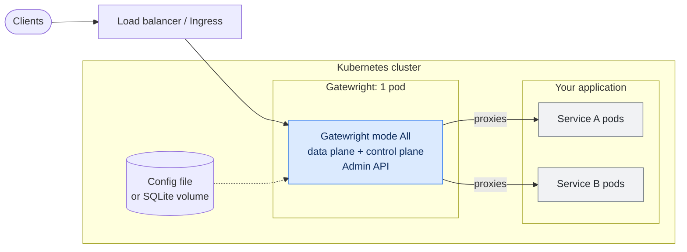
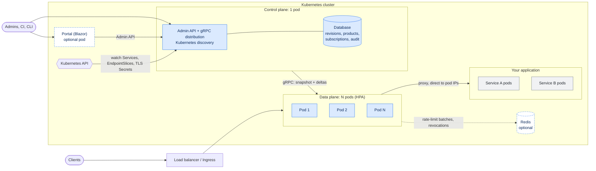
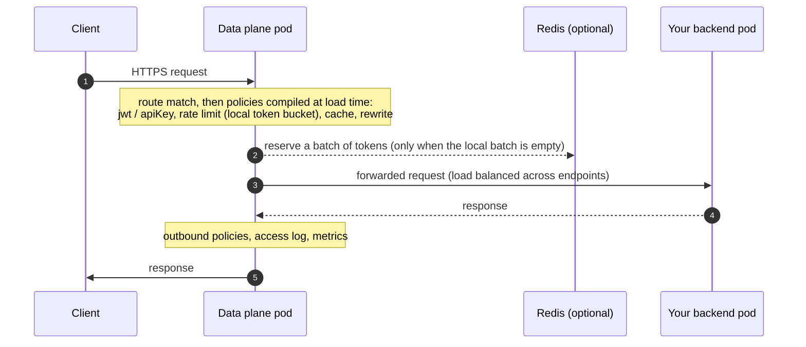
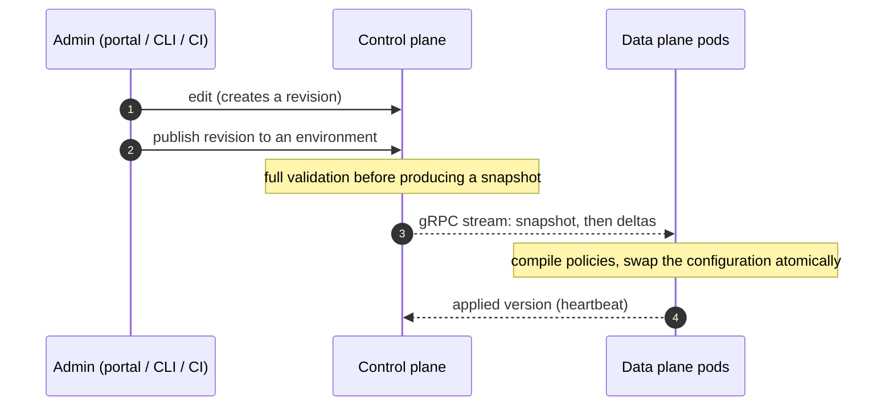

# Architecture and what you add to your cluster

Gatewright is **one binary** with three execution modes, selected by `Gateway:Mode`. The mode decides which pods you run next to your own application.

In every diagram: blue = Gatewright, grey = your application, dashed outline = optional.

> The Helm chart is not published yet (phase 13 of the roadmap): the pod counts below describe the topology the chart will deploy, and the
> [samples](../../samples/README.md) run the same topologies with Docker, Podman or Colima.

## At a glance

| Mode | Gatewright pods | Optional | Typical use |
|---|---|---|---|
| `All` | **1** (`gatewright`) | Redis, portal | development, demo, small installations |
| `ControlPlane` + `DataPlane` | **1** control plane + **N** data planes (start with 2) | Redis, portal | production |

Your application pods are never modified and receive no sidecar. Gatewright sits in front of them as the cluster entry point.

## Mode `All`: one pod

Control plane and data plane run in the same process. The configuration comes from a JSON file (reloaded on change) or from the built-in database
(`Gateway:ConfigSource=Database`, which also serves the Admin API). Distribution between the two parts is an in-memory channel.

Extra pods for the application team: **1**. Limits: it is a single point of failure and cannot scale the data plane independently. A restart does not lose
configuration (file or volume).

## Separate modes: control plane + data planes

The production topology. The **data plane** handles the traffic and is stateless; the **control plane** holds the configuration and pushes versioned
snapshots to the data planes over gRPC.

What each part needs:

| Part | Replicas | State | Kubernetes rights | Notes |
|---|---|---|---|---|
| Data plane | N ≥ 2 (HPA on CPU / requests) | none (keeps a local cache of the last good configuration) | **none** | the only component on the request path |
| Control plane | 1 | database (SQLite volume today; PostgreSQL is planned) | read Services, EndpointSlices, TLS Secrets; Leases | only component that talks to the Kubernetes API |
| Portal | 0 or 1 | none | none | optional; the CLI and Admin API do the same |
| Redis | 0 or 1 | counters, revocations | none | optional: without it rate limits and quotas are local to each data plane pod |

Extra pods for the application team: **1 control plane + N data planes** (+ portal, + Redis if you want them). With N = 2 that is **3 pods** minimum.

## What happens on a request

The data plane never calls the Kubernetes API, the control plane or the database while serving a request.

## What happens on a configuration change

If the control plane is down, **traffic keeps flowing**: each data plane pod continues with its last known good configuration and reconnects with
exponential backoff. You lose the ability to change configuration, not to serve requests.

## Choosing

- Start with **`All`** to try Gatewright or for a development namespace.
- Move to **control plane + data planes** when you need availability of the entry point (several data plane pods behind a load balancer),
  independent scaling, or a Kubernetes-side separation of rights (the data plane runs with no Kubernetes permissions).
- Add **Redis** when a limit must be global across data plane pods (shared `rateLimit`, strict `quota`) or key revocations must propagate within seconds.
- A **custom distribution** (your own policies) uses the same image for the control plane and the data planes, so both know the policy schemas:
  see [extending](extending.md) and `samples/04-custom-policy`.
- TLS can be terminated upstream (Front Door, Application Gateway, ingress) or by the data plane itself.
