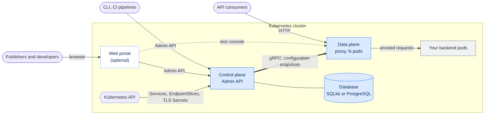
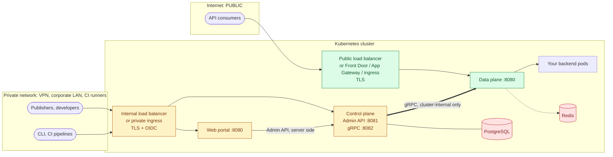

# Quickstart: run Gatewright on a local Kubernetes cluster

This guide installs Gatewright from its **published images and Helm chart**. You do not clone the repository, install .NET or build anything: you need a cluster, `kubectl` and `helm`.

Every command is given twice, for **zsh** (macOS, Linux) and for **PowerShell** (Windows PowerShell 5.1 or PowerShell 7 on any OS). Copy the block for your shell, in order.

1. [What you install](#1-what-you-install): the control plane, the data plane and the web portal.
2. [Choose an option](#2-choose-an-option): all-in-one or separate, with or without the portal.
3. [Create a local cluster](#3-create-a-local-cluster): kind, Colima, Kiri or Podman.
4. [Install Gatewright](#4-install-gatewright).
5. [Publish your first API and call it](#5-publish-your-first-api-and-call-it).
6. [Reach it without port-forward](#6-reach-it-without-port-forward).
7. [Public or private: what to expose](#7-public-or-private-what-to-expose).
8. [Going to production](#8-going-to-production), [troubleshooting](#troubleshooting), [clean up](#clean-up).

> **This is a try-out configuration.** Sign-in is disabled: the Admin API (`controlPlane.auth.developmentBypass`) and the portal (`portal.auth.mode=Development`) treat every caller as an administrator. Run it on a laptop cluster that nobody else can reach, and read [section 7](#7-public-or-private-what-to-expose) before exposing anything.

## 1. What you install

Gatewright has three parts. They all come from two images:

| Part | Image | Role | On the request path? |
|---|---|---|---|
| **Data plane** | `ghcr.io/pgourlain/gatewright-host` | The reverse proxy (YARP). Matches routes, runs policies (JWT, API keys, rate limits, cache…) and forwards to your backend pods. Stateless, scales horizontally. | **Yes**, it is the only one |
| **Control plane** | `ghcr.io/pgourlain/gatewright-host` (same image, another mode) | The **Admin API**: stores APIs, products, subscriptions and revisions in a database, validates a configuration and pushes it to the data planes over gRPC. Discovers annotated Kubernetes Services. | No |
| **Web portal** | `ghcr.io/pgourlain/gatewright-portal` | A browser UI on top of the Admin API: APIs, OpenAPI import, products, subscriptions and keys, revisions, and a test console that sends requests through the gateway. Optional: the Admin API and the CLI do the same. | No |

The data plane never calls the control plane, the database or the Kubernetes API while serving a request. It keeps the last configuration it received: if the control plane stops, traffic keeps flowing; you only lose the ability to change the configuration.



The control plane and the data plane are the **same binary** in different modes (`gateway.mode` in the chart):

- **All-in-one** (`gateway.mode=all`): one pod runs the control plane and the data plane together. The Admin API and the proxy share one port (8080). Simple, a single replica, a SQLite database on a volume. Ideal to try Gatewright or for a development namespace.
- **Separate** (`gateway.mode=separate`): control plane pods (Admin API on 8081, gRPC on 8082) and data plane pods (proxy on 8080) are distinct Deployments. Data planes scale on their own and the Admin API is never on the public port. This is the production shape.

More diagrams in [architecture](architecture.md).

## 2. Choose an option

| | **With the web portal** | **Without the portal** (Admin API, CLI, CI only) |
|---|---|---|
| **All-in-one** (`all`, SQLite) | **Option 1, start here.** 2 pods | Option 2. 1 pod |
| **Separate** (`separate`, bundled PostgreSQL) | Option 3, production-like. 6 pods | Option 4. 5 pods |

| Option | Pods created by the chart | Ports you open on your machine |
|---|---|---|
| 1 | `gatewright-all` (1), `gatewright-portal` (1) | 8080 gateway + Admin API, 8088 portal |
| 2 | `gatewright-all` (1) | 8080 gateway + Admin API |
| 3 | `gatewright-controlplane` (2, one elected leader), `gatewright-dataplane` (2), `gatewright-postgres-dev` (1), `gatewright-portal` (1) | 8080 gateway, 8081 Admin API, 8088 portal |
| 4 | same as 3 without the portal | 8080 gateway, 8081 Admin API |

The database is a choice of its own, changed with one line in the values file (see [Change the database](#change-the-database)):

| Database | Value | For |
|---|---|---|
| SQLite (default) | nothing to set | try-out; one control plane pod |
| Bundled PostgreSQL | `postgres: { dev: { enabled: true } }` | dev and test only (single non-managed `postgres:17-alpine`); two control plane pods with leader election |
| Your PostgreSQL | `postgres: { connectionString: "..." }` | production (Azure Database for PostgreSQL, RDS, Cloud SQL…) |

## 3. Create a local cluster

Pick **one** local cluster. Give it at least **4 CPUs and 6 GB of memory** (option 3 runs six pods). Skip this section if you already have a cluster and `kubectl` points to it.

| Local cluster | Runs on | Container engine | `kubectl` context |
|---|---|---|---|
| [kind](https://kind.sigs.k8s.io/) | macOS, Linux, Windows | Docker (Docker Desktop or any Docker engine) | `kind-gatewright` |
| [Colima](https://github.com/abiosoft/colima) | macOS, Linux | its own VM (k3s) | `colima` |
| [Podman](https://podman.io/) + kind | macOS, Linux, Windows | Podman machine | `kind-gatewright` |
| [Kiri](https://runkiri.com/) (beta) | macOS 14+, Linux, Windows (WSL2) | its own engine (k3s) | `kiri` |

### Tools

**zsh** (macOS, with [Homebrew](https://brew.sh/); keep only the cluster you chose on the second line):

```zsh
brew install kubectl helm
brew install kind            # or: colima | podman kind
```

Kiri is not in Homebrew: install it with `curl -fsSL https://runkiri.com/install.sh | bash` (macOS, Linux) or the disk image from [runkiri.com](https://runkiri.com/).

**PowerShell** (Windows, with winget; Colima is not available on Windows):

```powershell
winget install -e --id Kubernetes.kubectl
winget install -e --id Helm.Helm
winget install -e --id Kubernetes.kind      # or: RedHat.Podman and Kubernetes.kind
```

Kiri for Windows (beta) is an `.msi` installer from [runkiri.com](https://runkiri.com/); its first run sets up WSL2.

Open a new terminal afterwards so the new commands are on the `PATH`.

### kind (Docker)

Start Docker Desktop (or your Docker engine) first, with at least 4 CPUs and 6 GB of memory in its settings.

**zsh** and **PowerShell** (same commands):

```zsh
kind create cluster --name gatewright
kubectl config use-context kind-gatewright
```

### Colima (macOS, Linux)

**zsh**:

```zsh
colima start --kubernetes --cpu 4 --memory 6
kubectl config use-context colima
```

### Podman (with kind)

kind needs a rootful Podman machine.

**zsh**:

```zsh
podman machine init --cpus 4 --memory 6144 --rootful
podman machine start
export KIND_EXPERIMENTAL_PROVIDER=podman
kind create cluster --name gatewright
kubectl config use-context kind-gatewright
```

**PowerShell**:

```powershell
podman machine init --cpus 4 --memory 6144 --rootful
podman machine start
$env:KIND_EXPERIMENTAL_PROVIDER = 'podman'
kind create cluster --name gatewright
kubectl config use-context kind-gatewright
```

Podman Desktop can also create the kind cluster from its *Kubernetes* page; then only run the `kubectl config use-context` line.

### Kiri (beta)

[Kiri](https://runkiri.com/) runs a single-node k3s cluster next to its Docker engine. Give its VM 4 CPUs and 6 GB first: *Settings → Resources* in the Kiri window, then *Restart VM to apply* (see the [Kiri settings](https://docs.runkiri.com/settings/)).

**zsh** (macOS, Linux):

```zsh
kiri k8s start --use
kubectl config use-context kiri
```

`--use` makes `kiri` the current context; Kiri merges it into `~/.kube/config` (or the first file of `$KUBECONFIG`).

**PowerShell** (Windows): `kiri k8s` runs inside WSL. Start the cluster from the *Kubernetes* section of the Kiri window, then:

```powershell
kubectl config use-context kiri
```

Not tested with Gatewright yet. Details in the [Kiri Kubernetes documentation](https://docs.runkiri.com/kubernetes/).

### Check

**zsh** and **PowerShell**:

```zsh
kubectl get nodes
```

One node, `Ready`.

## 4. Install Gatewright

### 4.1 Pick the version

The chart is published in the GitHub container registry (OCI). The chart version also selects the image tags of the host and the portal, so one variable pins everything.

**zsh**:

```zsh
GW_VERSION=1.0.0-rc.2
helm show chart oci://ghcr.io/pgourlain/charts/gatewright --version $GW_VERSION
```

**PowerShell**:

```powershell
$GW_VERSION = '1.0.0-rc.2'
helm show chart oci://ghcr.io/pgourlain/charts/gatewright --version $GW_VERSION
```

The second command prints the chart metadata: if it fails, check the version on the [package page](https://github.com/pgourlain?tab=packages&repo_name=Gatewright). Prefer a Helm repository? `helm repo add gatewright https://pgourlain.github.io/Gatewright` then use `gatewright/gatewright` instead of the `oci://` reference (add `--devel` to see `-rc.N` versions in `helm search repo`). Other sources: [chart README](../../deploy/helm/gatewright/README.md#install).

### 4.2 Write the values file

The whole installation is described in one file, `gatewright-values.yaml`, in the current directory. Run the block of **your option** only.

#### Option 1: all-in-one with the web portal (recommended first try)

**zsh**:

```zsh
cat > gatewright-values.yaml <<'EOF'
gateway: { mode: all }
controlPlane: { auth: { developmentBypass: true } }  # try-out only: every caller is an administrator
all: { service: { type: ClusterIP } }
portal:
  enabled: true
  auth: { mode: Development }                        # try-out only: no sign-in
EOF
```

**PowerShell**:

```powershell
@'
gateway: { mode: all }
controlPlane: { auth: { developmentBypass: true } }  # try-out only: every caller is an administrator
all: { service: { type: ClusterIP } }
portal:
  enabled: true
  auth: { mode: Development }                        # try-out only: no sign-in
'@ | Set-Content -Encoding ascii gatewright-values.yaml
```

#### Option 2: all-in-one without the portal

**zsh**:

```zsh
cat > gatewright-values.yaml <<'EOF'
gateway: { mode: all }
controlPlane: { auth: { developmentBypass: true } }  # try-out only: every caller is an administrator
all: { service: { type: ClusterIP } }
EOF
```

**PowerShell**:

```powershell
@'
gateway: { mode: all }
controlPlane: { auth: { developmentBypass: true } }  # try-out only: every caller is an administrator
all: { service: { type: ClusterIP } }
'@ | Set-Content -Encoding ascii gatewright-values.yaml
```

#### Option 3: separate control plane and data planes, with the web portal

**zsh**:

```zsh
cat > gatewright-values.yaml <<'EOF'
gateway: { mode: separate }
controlPlane: { auth: { developmentBypass: true } }  # try-out only: every caller is an administrator
dataPlane: { service: { type: ClusterIP } }
postgres: { dev: { enabled: true } }                 # dev/test only: bundled PostgreSQL
portal:
  enabled: true
  auth: { mode: Development }                        # try-out only: no sign-in
EOF
```

**PowerShell**:

```powershell
@'
gateway: { mode: separate }
controlPlane: { auth: { developmentBypass: true } }  # try-out only: every caller is an administrator
dataPlane: { service: { type: ClusterIP } }
postgres: { dev: { enabled: true } }                 # dev/test only: bundled PostgreSQL
portal:
  enabled: true
  auth: { mode: Development }                        # try-out only: no sign-in
'@ | Set-Content -Encoding ascii gatewright-values.yaml
```

#### Option 4: separate control plane and data planes, without the portal

**zsh**:

```zsh
cat > gatewright-values.yaml <<'EOF'
gateway: { mode: separate }
controlPlane: { auth: { developmentBypass: true } }  # try-out only: every caller is an administrator
dataPlane: { service: { type: ClusterIP } }
postgres: { dev: { enabled: true } }                 # dev/test only: bundled PostgreSQL
EOF
```

**PowerShell**:

```powershell
@'
gateway: { mode: separate }
controlPlane: { auth: { developmentBypass: true } }  # try-out only: every caller is an administrator
dataPlane: { service: { type: ClusterIP } }
postgres: { dev: { enabled: true } }                 # dev/test only: bundled PostgreSQL
'@ | Set-Content -Encoding ascii gatewright-values.yaml
```

#### Change the database

Edit the `postgres` line of the file:

- **SQLite**: remove the line. In `separate` mode the chart then runs a single control plane pod.
- **Bundled PostgreSQL**: `postgres: { dev: { enabled: true } }`.
- **Your PostgreSQL**: create an empty database and a user that owns it, then `postgres: { connectionString: "Host=my-postgres.example.com;Database=gatewright;Username=gatewright;Password=CHANGE_ME;SSL Mode=Require" }`. It is a standard [Npgsql connection string](https://www.npgsql.org/doc/connection-string-parameters.html); the chart stores it in a Kubernetes Secret. Do not commit a values file that contains a password.

Migrations run automatically when the control plane starts.

### 4.3 Install

**zsh** and **PowerShell** (same command):

```zsh
helm upgrade --install gatewright oci://ghcr.io/pgourlain/charts/gatewright --version $GW_VERSION --namespace gatewright --create-namespace -f gatewright-values.yaml
```

`upgrade --install` installs on the first run and upgrades afterwards: to change the installation, edit the file and run the same command again.

### 4.4 Wait until it is ready

The first start pulls the images (a minute or two).

**Options 1 and 2**, zsh and PowerShell:

```zsh
kubectl --namespace gatewright wait --for=condition=ready pod -l app.kubernetes.io/component=all --timeout=300s
```

**Options 3 and 4**, zsh and PowerShell:

```zsh
kubectl --namespace gatewright wait --for=condition=ready pod -l app.kubernetes.io/component=controlplane --timeout=300s
```

**With the portal** (options 1 and 3), also:

```zsh
kubectl --namespace gatewright wait --for=condition=ready pod -l app.kubernetes.io/component=portal --timeout=300s
```

In options 3 and 4 the data plane pods stay *not ready* until the first publication in the next step. That is expected: a data plane never takes traffic without a valid configuration.

### 4.5 Open the ports on your machine

`kubectl port-forward` works the same on every local cluster. The commands below run in the background of the current terminal. Run only the lines of your option.

**zsh**:

```zsh
# Options 1 and 2: gateway and Admin API on the same port
kubectl --namespace gatewright port-forward svc/gatewright-all 8080:8080 >/dev/null &
GW_ADMIN=http://localhost:8080

# Options 3 and 4: Admin API (the data plane comes in step 5.3)
kubectl --namespace gatewright port-forward svc/gatewright-controlplane 8081:8081 >/dev/null &
GW_ADMIN=http://localhost:8081

# Options 1 and 3: web portal
kubectl --namespace gatewright port-forward svc/gatewright-portal 8088:8080 >/dev/null &
```

**PowerShell**:

```powershell
$pf = @()

# Options 1 and 2: gateway and Admin API on the same port
$pf += Start-Job { kubectl --namespace gatewright port-forward svc/gatewright-all 8080:8080 }
$GW_ADMIN = 'http://localhost:8080'

# Options 3 and 4: Admin API (the data plane comes in step 5.3)
$pf += Start-Job { kubectl --namespace gatewright port-forward svc/gatewright-controlplane 8081:8081 }
$GW_ADMIN = 'http://localhost:8081'

# Options 1 and 3: web portal
$pf += Start-Job { kubectl --namespace gatewright port-forward svc/gatewright-portal 8088:8080 }
```

Stop them later with `kill %1 %2 %3` (zsh, see `jobs`) or `$pf | Stop-Job; $pf | Remove-Job` (PowerShell).

**With the portal**, open <http://localhost:8088>. No sign-in is asked in this try-out configuration.

## 5. Publish your first API and call it

### 5.1 Deploy a sample backend

A tiny echo service in the same namespace. **zsh**:

```zsh
cat <<'EOF' | kubectl --namespace gatewright apply -f -
apiVersion: apps/v1
kind: Deployment
metadata: { name: echo }
spec:
  selector: { matchLabels: { app: echo } }
  template:
    metadata: { labels: { app: echo } }
    spec:
      containers:
        - name: echo
          image: hashicorp/http-echo:1.0
          args: ["-listen=:8080", "-text=hello-from-backend"]
          ports: [{ containerPort: 8080 }]
---
apiVersion: v1
kind: Service
metadata: { name: echo }
spec:
  selector: { app: echo }
  ports: [{ port: 80, targetPort: 8080 }]
EOF
kubectl --namespace gatewright rollout status deployment/echo --timeout=120s
```

**PowerShell**:

```powershell
@'
apiVersion: apps/v1
kind: Deployment
metadata: { name: echo }
spec:
  selector: { matchLabels: { app: echo } }
  template:
    metadata: { labels: { app: echo } }
    spec:
      containers:
        - name: echo
          image: hashicorp/http-echo:1.0
          args: ["-listen=:8080", "-text=hello-from-backend"]
          ports: [{ containerPort: 8080 }]
---
apiVersion: v1
kind: Service
metadata: { name: echo }
spec:
  selector: { app: echo }
  ports: [{ port: 80, targetPort: 8080 }]
'@ | kubectl --namespace gatewright apply -f -
kubectl --namespace gatewright rollout status deployment/echo --timeout=120s
```

### 5.2 Declare the API and publish it

Declare an API `echo` on the path `/echo`, then publish the configuration to the `dev` environment (the one the chart serves by default). **zsh**:

```zsh
curl -sf -X POST $GW_ADMIN/admin/v1/apis -H 'content-type: application/json' \
  -d '{"name":"echo","basePath":"/echo","backend":{"destinations":["http://echo.gatewright.svc.cluster.local"]}}'

curl -sf -X POST $GW_ADMIN/admin/v1/environments/dev/publications -H 'content-type: application/json' -d '{}'
```

**PowerShell**:

```powershell
Invoke-RestMethod -Method Post -Uri "$GW_ADMIN/admin/v1/apis" -ContentType 'application/json' `
  -Body '{"name":"echo","basePath":"/echo","backend":{"destinations":["http://echo.gatewright.svc.cluster.local"]}}'

Invoke-RestMethod -Method Post -Uri "$GW_ADMIN/admin/v1/environments/dev/publications" -ContentType 'application/json' -Body '{}'
```

**With the portal**, refresh <http://localhost:8088>: the `echo` API is listed under *APIs* and the publication under *Revisions*. You can also declare APIs there, or import an OpenAPI document from *Import API*, then publish.

### 5.3 Call it through the gateway

**Options 3 and 4 only**: the data plane pods become ready within seconds of the publication. Wait for them, then open the gateway port. zsh:

```zsh
kubectl --namespace gatewright wait --for=condition=ready pod -l app.kubernetes.io/component=dataplane --timeout=120s
kubectl --namespace gatewright port-forward svc/gatewright-dataplane 8080:8080 >/dev/null &
```

PowerShell:

```powershell
kubectl --namespace gatewright wait --for=condition=ready pod -l app.kubernetes.io/component=dataplane --timeout=120s
$pf += Start-Job { kubectl --namespace gatewright port-forward svc/gatewright-dataplane 8080:8080 }
```

Then, for every option, **zsh**:

```zsh
curl -i http://localhost:8080/echo
```

**PowerShell**:

```powershell
Invoke-WebRequest -UseBasicParsing http://localhost:8080/echo | Select-Object StatusCode, Content
```

You get `200` and `hello-from-backend`. With the portal, the *Test console* page sends the same request through the gateway and shows the response.

### 5.4 Optional: shared rate limits with Redis

Without Redis, rate limits and quotas are counted per data plane pod. For a shared budget add **one** line to `gatewright-values.yaml` and run the `helm upgrade --install` command of step 4.3 again:

```yaml
redis: { dev: { enabled: true } }                                                       # dev/test: bundled, non-persistent
redis: { connectionString: "my-redis.example.com:6380,password=CHANGE_ME,ssl=true" }   # production: your own Redis
```

Details in [getting started](getting-started.md#shared-state-with-redis).

## 6. Reach it without port-forward

Each entry point is a Kubernetes `Service`. This quickstart sets them to `ClusterIP` (reachable through port-forward only). Change the type to `LoadBalancer` in `gatewright-values.yaml` and run step 4.3 again:

| Entry point | Value | Chart default |
|---|---|---|
| Gateway, options 1 and 2 (proxy **and** Admin API) | `all: { service: { type: LoadBalancer } }` | `LoadBalancer`, port 8080 |
| Data plane, options 3 and 4 | `dataPlane: { service: { type: LoadBalancer } }` | `LoadBalancer`, port 8080 |
| Admin API, options 3 and 4 | `controlPlane.service.type` | `ClusterIP`: keep it private |
| Web portal | `portal: { service: { type: LoadBalancer, port: 8088 } }` | `ClusterIP`, port 8080 |

Give the portal a port different from the gateway's, or two load balancers collide on 8080. Then list the addresses:

```zsh
kubectl --namespace gatewright get svc     # EXTERNAL-IP column
```

How each local cluster handles a `LoadBalancer`:

| Local cluster | Behaviour |
|---|---|
| **Colima** | The bundled k3s load balancer answers on `localhost`: the gateway on <http://localhost:8080> works (tested; stop the port-forward first, it holds the same port). A second load balancer for the portal was not reachable from the Mac (ports 8088 and 8090 tried): keep the port-forward for the portal. |
| **Kiri** | Each `LoadBalancer` service gets its port on `localhost`, per the [Kiri documentation](https://docs.runkiri.com/kubernetes/): the gateway on <http://localhost:8080>, the portal on <http://localhost:8088> (stop the port-forwards first, they hold the same ports). Not tested with Gatewright. |
| **kind**, **Podman + kind** | A `LoadBalancer` stays `<pending>` without an add-on such as [cloud-provider-kind](https://github.com/kubernetes-sigs/cloud-provider-kind) or MetalLB (not tested). Keep the port-forward. |
| **AKS, EKS, GKE** | The cloud provider assigns a public IP within a minute: read [section 7](#7-public-or-private-what-to-expose) first. |

> **A public address exposes whatever it fronts.** In options 1 and 2 the Admin API is on the gateway port: with `developmentBypass` a reachable gateway gives every visitor administrator rights, and `portal.auth.mode=Development` does the same for the portal.

## 7. Public or private: what to expose

Only the **data plane** is meant for API consumers. Everything else is for your team, your pipelines or the cluster itself.



| Component (Service) | Port | Called by | Exposure |
|---|---|---|---|
| Data plane (`gatewright-dataplane`) | 8080 (HTTPS if Gatewright terminates TLS) | API consumers | **Public**: `LoadBalancer`, or behind Front Door, Application Gateway or an ingress (then set `Gateway:ForwardedHeaders:TrustedProxies`) |
| Admin API (`gatewright-controlplane`) | 8081 | portal, CLI, CI | **Private**: internal load balancer or private ingress, reachable from your network and CI runners only, always with OIDC |
| gRPC distribution (`gatewright-controlplane`) | 8082 | data plane pods | **Cluster-internal only**: never expose it outside the cluster |
| Web portal (`gatewright-portal`) | 8080 | publishers, developers (browser) | **Private** by default. Public only behind HTTPS with OIDC sign-in (`portal.auth.authority`, `clientId`, `clientSecret`). The portal calls the Admin API server side, so a public portal does not require a public Admin API |
| All-in-one (`gatewright-all`) | 8080 | everyone: proxy **and** Admin API on one port | **Private**: exposing it exposes the Admin API. For public traffic use the separate mode |
| PostgreSQL, Redis | | control plane, data plane | **Private**: in-cluster or private endpoints, never public |
| Kubernetes API | | control plane only | The data plane has no Kubernetes rights and mounts no service account token |

The chart enables a `NetworkPolicy` (`networkPolicy.enabled=true`) that only lets each pod receive traffic on its own service port; it takes effect with a CNI that enforces network policies (Calico, Cilium, Azure CNI…).

## 8. Going to production

A production installation uses the separate mode, your own PostgreSQL, OIDC sign-in and a public data plane. Starting point (replace every placeholder; keep the file out of source control, or pass secrets with `--set-string` from your secret store):

```yaml
gateway: { mode: separate, environment: prod }
controlPlane:
  auth:
    authority: https://login.microsoftonline.com/<tenant-id>/v2.0   # any OIDC provider
    audience: <admin-api-client-id>                                 # roles Admin, Publisher, Reader from the "roles" claim
  service: { type: ClusterIP }                                      # expose through a private ingress, never publicly
dataPlane:
  service: { type: LoadBalancer }                                   # or ClusterIP behind your own ingress / Front Door
  autoscaling: { enabled: true, minReplicas: 3, maxReplicas: 10 }
postgres: { connectionString: "Host=...;Database=gatewright;Username=...;Password=...;SSL Mode=Require" }
redis: { connectionString: "my-redis.example.com:6380,password=...,ssl=true" }
portal:
  enabled: true
  auth:
    authority: https://login.microsoftonline.com/<tenant-id>/v2.0
    clientId: <portal-client-id>
    clientSecret: <portal-client-secret>
```

Checklist:

1. **No try-out settings**: no `developmentBypass`, no `portal.auth.mode=Development`, no bundled PostgreSQL or Redis, no SQLite.
2. **Pin the chart version** (`--version`); the image tags follow it. Never deploy `edge` or commit tags.
3. **Expose only the data plane publicly** ([section 7](#7-public-or-private-what-to-expose)). Behind a proxy that terminates TLS, set `gateway.extraEnv.Gateway__ForwardedHeaders__TrustedProxies__0` to its address so client IPs are the real ones.
4. **Size and monitor** the data plane: see the chart's [`values.yaml`](../../deploy/helm/gatewright/values.yaml), [operations](operations.md), [observability](observability.md) and [security](security.md).

## Troubleshooting

| Symptom | Cause and fix |
|---|---|
| `helm show chart` or `helm install` fails with `not found` | Wrong `GW_VERSION`: check the [package page](https://github.com/pgourlain?tab=packages&repo_name=Gatewright). OCI references always need `--version`. |
| Pod stuck in `ImagePullBackOff` | The cluster cannot reach `ghcr.io` (proxy, offline machine) or the tag does not exist: `kubectl --namespace gatewright describe pod <pod>`. |
| Pods stay `Pending` | Not enough CPU or memory in the local cluster: give it 4 CPUs and 6 GB ([section 3](#3-create-a-local-cluster)). |
| `port-forward` fails with `address already in use` | Another process holds the port (an older port-forward, or Colima forwarding a `LoadBalancer`). Stop it, or use another local port (`8090:8080`). |
| Data plane pods never become ready (options 3, 4) | Nothing is published yet: publish (step 5.2). |
| Admin API returns `401` or `403` | Neither an OIDC authority nor `developmentBypass` is set. |
| Portal pod crash-loops: `Portal:Auth:Authority and Portal:Auth:ClientId are required` | Set `portal.auth.mode: Development` (try-out) or the OIDC settings. |
| `curl http://localhost:8080/echo` returns `404` | The publication did not happen, or (options 3, 4) port 8080 is forwarded to the control plane instead of the data plane. |
| Control plane crash-loops with a PostgreSQL error | Check the connection string, that the database exists and that the user can create tables: `kubectl --namespace gatewright logs deploy/gatewright-controlplane` (or `deploy/gatewright-all`). |
| `cannot re-use a name that is still in use` | You used `helm install`: use `helm upgrade --install` (step 4.3), or `helm uninstall gatewright --namespace gatewright` first. |

## Clean up

Remove Gatewright and the sample (zsh and PowerShell):

```zsh
helm uninstall gatewright --namespace gatewright
kubectl delete namespace gatewright
```

The SQLite volume and the bundled PostgreSQL volume are deleted with the namespace; an external PostgreSQL is left untouched.

Delete the local cluster:

| Local cluster | Command |
|---|---|
| kind | `kind delete cluster --name gatewright` |
| Colima | `colima delete` |
| Podman + kind | zsh: `KIND_EXPERIMENTAL_PROVIDER=podman kind delete cluster --name gatewright`; PowerShell: `$env:KIND_EXPERIMENTAL_PROVIDER = 'podman'; kind delete cluster --name gatewright`; then `podman machine stop` |
| Kiri | `kiri k8s delete` (Windows: from the Kiri window, or `kiri k8s delete` inside WSL) |

## Next steps

- Declare APIs from OpenAPI documents, the portal or .NET code: [declaring APIs](declaring-apis.md), [x-gateway](x-gateway.md), [CLI](cli.md).
- Let Gatewright discover your Services through annotations: [Kubernetes discovery](getting-started.md#kubernetes-discovery).
- Add policies (JWT, API keys, rate limits, cache…): [built-in policies](policies.md).
- Write your own policy in C# and ship your own image: [extending](extending.md).
- Build the images yourself or work on the chart: clone the repository and see the [chart README](../../deploy/helm/gatewright/README.md).
